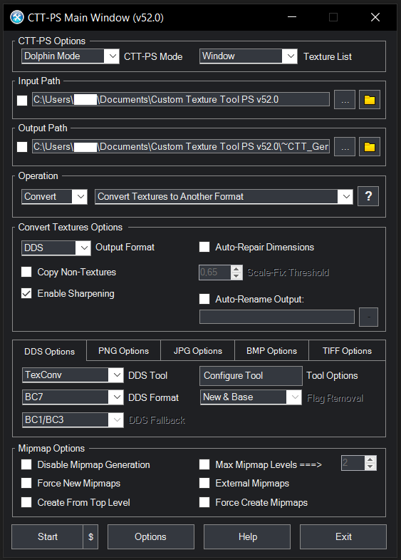

# **Super Mario Eclipse - High-Res Texture Pack**

This repository contains a high-resolution texture pack for **Super Mario Eclipse**, a modification of Super Mario Sunshine. The same pack also works with vanilla Super Mario Sunshine.

The repository stores the pack as PNG and as DDS. The **release** is the DDS pack only. PNG is the working copy used for editing and upscaling.

## **Table of Contents**
1. [Texture Pack](#texture-pack)
2. [How to Install Custom Textures in Dolphin](#how-to-install-custom-textures-in-dolphin)
3. [Upscaling Process](#upscaling-process)
4. [Converting PNG to DDS](#converting-png-to-dds)
5. [Unmodified Texture Dumps](#unmodified-texture-dumps)
6. [Texture Dumping Tool](#texture-dumping-tool)
7. [Contributing](#contributing)
8. [Credits](#credits)
9. [Contact](#contact)

---

## **Texture Pack**

The pack is stored in two folders:

- `PNG/GMSE04` holds the upscaled PNG source files.
- `DDS/GMSE04` holds the converted DDS files that Dolphin loads. This is the folder published in **Releases**.

---

## **How to Install Custom Textures in Dolphin**

### **1. Preparing Dolphin Emulator**
Install the latest Dolphin from [https://dolphin-emu.org/](https://dolphin-emu.org/).

### **2. Configuring Dolphin Emulator Settings**
In `Graphics Settings` > `Advanced`:

- Enable **Load Custom Textures**.
- Disable **Prefetch Custom Textures**.

### **3. Increasing Internal Resolution**
In `Graphics Settings` > `Enhancements`, set **Internal Resolution** to match the display. A higher internal resolution shows more of the texture detail.

### **4. Place Textures in the Correct Directory**
Dolphin's user directory:

- **Windows**: `%appdata%\Dolphin Emulator\Load\Textures\`
- **macOS**: `~/Library/Application Support/Dolphin/Load/Textures/`
- **Linux**: `~/.local/share/dolphin-emu/Load/Textures/`

The release zip contains a `GMSE04` folder. Copy that folder into `Load/Textures`.

If `Load/Textures/GMSE04` already exists, rename or delete that folder before copying the new one in. To combine this pack with another texture pack, leave the existing folder in place, copy the new files into it, and overwrite files that share the same path.

### **5. Launching the Game**
Start **Super Mario Eclipse** in Dolphin. The DDS textures load automatically.

---

## **Upscaling Process**

Upscale with **chaiNNer**:

1. Install the latest chaiNNer from [https://github.com/chaiNNer-org/chaiNNer/releases](https://github.com/chaiNNer-org/chaiNNer/releases).
2. In the Dependency Manager, install `PyTorch`, `NCNN`, and `ONNX`, including every sub-package.
3. Open `OTHER_FILES/UPSCALING.chn` and download the four models from [https://github.com/Venomalia/Hdcube](https://github.com/Venomalia/Hdcube).
4. Set the input folder, the output folder, and the four model paths.
5. Press **Start**. The lock icon at the bottom left stops accidental edits while the chain is running.

Keep each upscaled PNG at the same relative path it had under `PNG/GMSE04`, so it replaces the existing file instead of sitting next to it in another folder.

---

## **Converting PNG to DDS**

Dolphin loads the DDS files. After a PNG is added or replaced, convert it with **[Custom Texture Tool PS](https://github.com/BigheadSMZ/Custom-Texture-Tool-PS)** and put the DDS at the same path under `DDS/GMSE04`.

**Settings:**

Keep the Dolphin filename and change only the extension from `.png` to `.dds`. The folder path under `DDS/GMSE04` must match the PNG. A different subfolder leaves the old DDS in place.

Textures with `_m_` in the name are mipmapped by the game. If one of those turns into a color smear at high internal resolution, convert that file again with **Disable Mipmap Generation** enabled, so the DDS keeps a single mip level.

---

## **Unmodified Texture Dumps**

Original dumps, before any upscale:

- `TEXTURE_DUMPS_ECLIPSE/GMSE04` is Super Mario Eclipse.
- `TEXTURE_DUMPS_PAL_VANILLA/GMSP01` is PAL Super Mario Sunshine.

Use the same relative path as `PNG/GMSE04` and `DDS/GMSE04` when adding a dumped texture, so a later copy overwrites the existing file.

---

## **Texture Dumping Tool**

Textures can be extracted with **DolphinTextureExtraction-tool**:

- **Download**: [https://github.com/Venomalia/DolphinTextureExtraction-tool](https://github.com/Venomalia/DolphinTextureExtraction-tool)

HUD, UI, and font textures are not all captured automatically and may need a manual dump.

---

## **Contributing**

1. Fork the repository.
2. Add or replace the PNG in `PNG/GMSE04` and the matching DDS in `DDS/GMSE04`, at the same relative path.
3. Open a pull request against `main` and describe the change.

A change that updates only the PNG, or that puts the DDS in a different subfolder, will not be merged. The release is built from `DDS/GMSE04`.

Questions and suggestions: **Super Mario Eclipse Discord**  
[https://discord.com/invite/u6NHuHVRpJ](https://discord.com/invite/u6NHuHVRpJ)

---

## **Credits**

- **iZePlayz**: Creator of the high-resolution textures.
- **AlexWolfz**: Converted the textures to DDS.
- **Venomalia**: Dolphin texture dumping tool and upscaling models.
- **CoNesTra**: Autosave and loading icons.
- **KaonsYT**: HUD textures for the characters and the water meter.
- **CanOfDarkFruit**: Textures made and shared on Discord.
- **Many other people from the Super Mario Eclipse Discord Server.**

---

## **Contact**

GitHub or the Discord server linked above.
